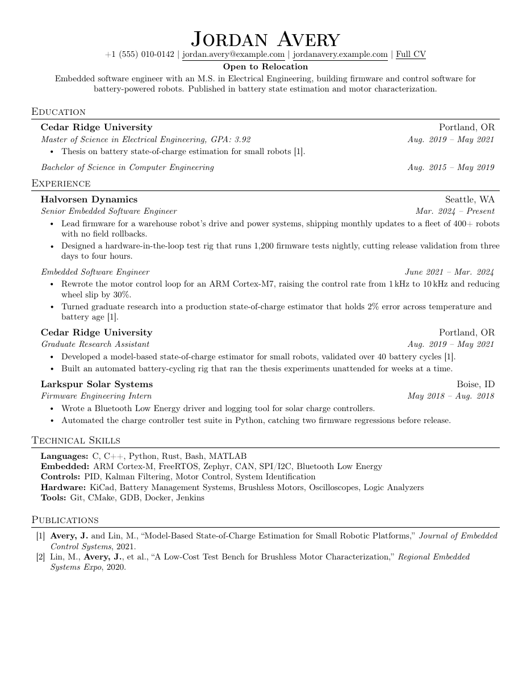
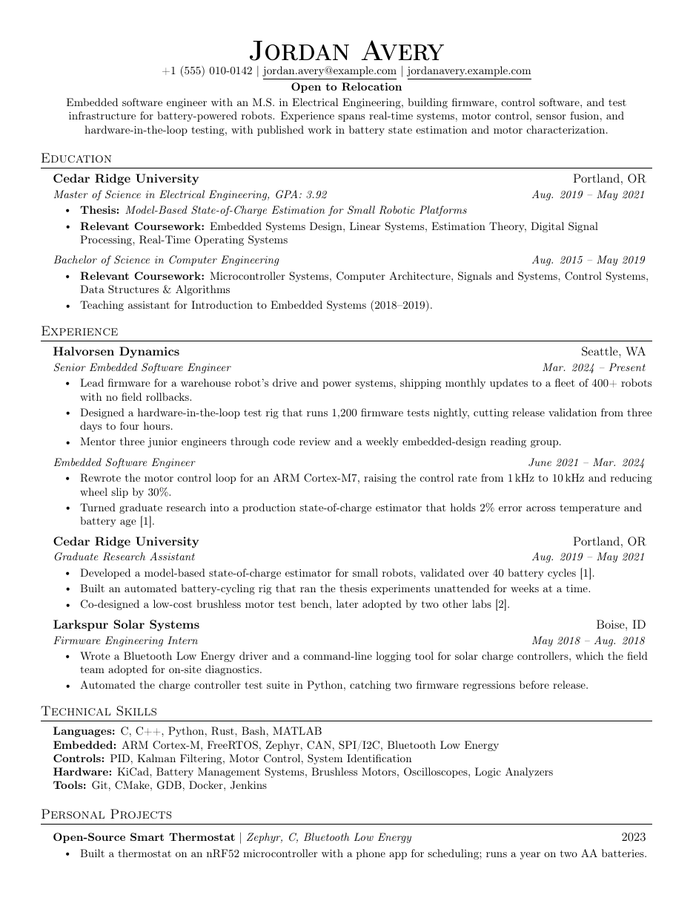
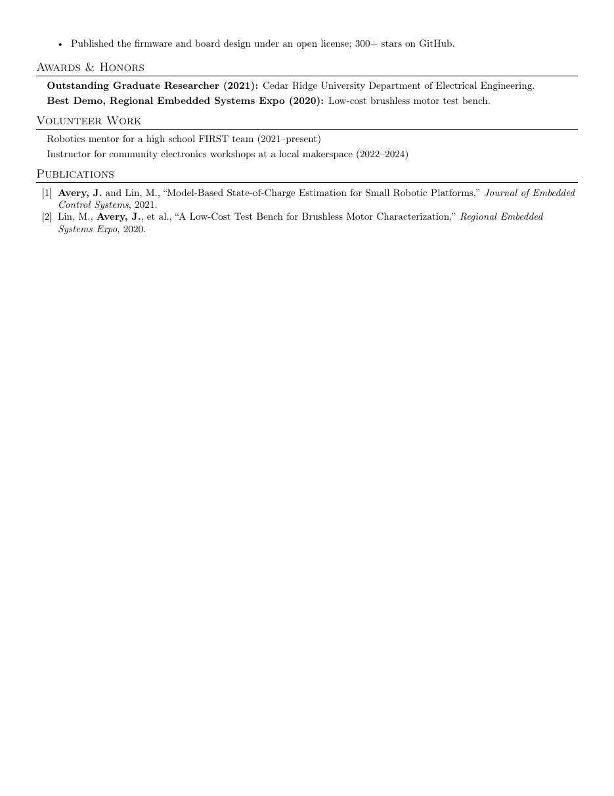

# Dual Resume/CV Template

A LaTeX template that builds a one-page **resume** and a full **CV** from the
same source files. Write each entry once, mark only the lines that differ
between the two, and both documents stay in sync. Works in Overleaf or
locally, and a GitHub Action builds both PDFs on every push.

The style is based on [Jake's Resume](https://github.com/jakegut/resume).

<p align="center">
  
  
  
</p>
<p align="center"><sub>
  The example resume (left) and CV (right), built from the same files.
  Jordan Avery and every school, employer, and publication shown are
  fictional.
</sub></p>

## Features

- **One source, two documents.** `resume.tex` and `cv.tex` share every
  section file. Three commands mark what belongs to only one of them.
- **Entries built for real careers.** List an organization once with several
  titles under it, for a promotion or two degrees from the same school, each
  with its own bullets.
- **Numbered publications** with cross-references: cite `[1]` from a thesis
  or a job bullet, and the number follows the publication list.
- **Predictable page fit.** Vertical spacing never stretches or squeezes,
  and a heading never ends up alone at the bottom of a page.
- **ATS-friendly PDFs** with selectable, searchable text.
- **Automatic builds.** GitHub Actions compiles both PDFs on every push and
  can publish them with GitHub Pages.

## Quick start

1. Click **Use this template** > **Create a new repository**.
2. Open it in one of the three ways below.
3. Replace Jordan Avery's details in `sections/` with your own. Comments in
   each file explain the features as they come up.
4. Set `PDF_NAME` at the top of `.github/workflows/build-pdfs.yml` to your
   name, e.g. `Jane_Doe`.

### Overleaf with GitHub sync (paid Overleaf plans)

1. In Overleaf: **New Project** > **Import from GitHub**, and pick your new
   repository.
2. Set **Menu** > **Settings** > **Main document** to `resume.tex`. Switch it
   to `cv.tex` to view the CV. Overleaf picks a main document on import,
   and it may pick the wrong one.
3. Edit in Overleaf, then push to GitHub from Overleaf's GitHub sync dialog.

Overleaf syncs only the default branch (`main`). Nothing syncs on its own:
changes made on GitHub reach Overleaf only when you pull them from that same
dialog.

### Overleaf without sync (free)

1. On GitHub: **Code** > **Download ZIP**.
2. In Overleaf: **New Project** > **Upload Project**, and choose the zip.
3. Set the main document as above.

Edits made this way stay in Overleaf. To keep them in Git, download the
source from Overleaf and commit it.

### Locally

Install TeX Live. On Debian or Ubuntu, install the packages the GitHub
Action uses, plus `latexmk`:

```sh
sudo apt-get install texlive-latex-base texlive-latex-recommended \
  texlive-latex-extra texlive-fonts-recommended cm-super latexmk
```

Then build both documents:

```sh
latexmk -pdf resume.tex cv.tex
```

Or run `pdflatex` twice per document. The second run fills in the
publication numbers.

## How it works

```
resume.tex          the resume: \input{main}
cv.tex              the CV: \def\buildcv{} then \input{main}
main.tex            which sections appear, and in what order
sections/
  preamble.tex      paper size, packages, margins, spacing
  macros.tex        resume/CV switches and entry commands
  heading.tex       name, contact line, summary
  education.tex     one file per section
  experience.tex
  ...
.github/workflows/
  build-pdfs.yml    builds both PDFs on every push
docs/               images for this README
```

### Entries

An entry is an organization row followed by one or more title rows, each
with optional bullets. Entries go between `\resumeSubHeadingListStart` and
`\resumeSubHeadingListEnd`, bullets between `\resumeItemListStart` and
`\resumeItemListEnd`:

```latex
\resumeSubHeadingListStart
    \resumeOrg{Halvorsen Dynamics}{Seattle, WA}
    \resumeTitle{Senior Embedded Software Engineer}{Mar. 2024 -- Present}
    \resumeItemListStart
        \resumeItem{Lead firmware for a warehouse robot's drive system.}
    \resumeItemListEnd
    \resumeTitle{Embedded Software Engineer}{June 2021 -- Mar. 2024}
    \resumeItemListStart
        \resumeItem{Rewrote the motor control loop for an ARM Cortex-M7.}
    \resumeItemListEnd
\resumeSubHeadingListEnd
```

| Command                                   | Prints                           |
| ----------------------------------------- | -------------------------------- |
| `\resumeOrg{organization}{location}`      | Bold row that starts an entry    |
| `\resumeTitle{title or degree}{dates}`    | Italic row; repeat for more      |
| `\resumeItem{text}`                       | A bullet                         |
| `\resumeProjectHeading{name}{date}`       | Project row: name, tools, date   |
| `\resumeSubItem{text}`                    | Unbulleted line, as in Awards    |

### Resume or CV

Text with no switch appears in both documents. Wrap anything that differs:

| Command                          | Resume          | CV             |
| -------------------------------- | --------------- | -------------- |
| `\cvonly{...}`                   | hidden          | shown          |
| `\resumeonly{...}`               | shown           | hidden         |
| `\cvresume{for CV}{for resume}`  | second argument | first argument |

```latex
\resumeItem{Shared bullet, in both documents.}
\cvonly{\resumeItem{A bullet only the CV needs.}}
\cvresume{\resumeItem{The long version, for the CV.}}
         {\resumeItem{The short version, for the resume.}}
```

The switches work on anything: a bullet, a whole bullet list, part of a
line, or the summary. To drop whole sections from the resume, `main.tex`
wraps them in `\ifcv ... \fi`; move sections in or out of that block to
choose what the resume shows.

Switch arguments can't contain verbatim text, so escape `%` and `#` in any
URL inside them as `\%` and `\#`.

### Publications

```latex
\pubitem{avery2021soc}{\textbf{Avery, J.} and Lin, M., ``Title,'' 2021.}
```

`\pubitem{key}{citation}` numbers an entry in `sections/publications.tex`.
`\pubcite{key}` prints that number, e.g. `[1]`, anywhere else in the
document. Numbers follow the order of the list. An unknown key prints `[??]`
and fails the GitHub Action, so typos can't reach a published PDF.

### Page fit

All spacing is fixed: lists, paragraphs, and headings never stretch or
shrink to fill a page. Content that runs long moves to the next page
instead of compressing the lines above it, so what you see after an edit is
the real spacing. Section and entry headings always stay on the same page
as what follows them, and the skills block stays together.

If the resume spills onto a second page, the GitHub Action warns about it.
Shorten a bullet, or move it into `\cvonly{...}`.

### Paper size

US Letter is the default. For A4, change `letterpaper` to `a4paper` on the
`\documentclass` line of `sections/preamble.tex`. The margins adapt, but A4
is narrower and taller, so check that the resume still fits on one page.

### Fonts

The default is Computer Modern. `sections/preamble.tex` lists alternative
fonts, commented out; uncomment one to use it. Overleaf has all of them;
locally, some need the `texlive-fonts-extra` package.

## GitHub Actions and Pages

`.github/workflows/build-pdfs.yml` runs on every push to `main`, including
pushes from Overleaf, and can be run by hand from the Actions tab. Its two
settings are at the top of the file:

```yaml
env:
  PDF_NAME: Jordan_Avery    # Jordan_Avery_Resume.pdf, Jordan_Avery_CV.pdf
  PUBLISH_PAGES: "false"    # "true" also publishes them with GitHub Pages
```

**Download the PDFs:** open the **Actions** tab, then the latest run. Both
PDFs are under **Artifacts** as a zip, kept for 90 days by default.

**Publish them on the web** (optional):

1. **Settings** > **Pages** > **Source**: **GitHub Actions**.
2. Set `PUBLISH_PAGES: "true"` and push.

The PDFs then live at a stable address that updates with every push:

```
https://<username>.github.io/<repository>/<PDF_NAME>_Resume.pdf
https://<username>.github.io/<repository>/<PDF_NAME>_CV.pdf
```

If your user site uses a custom domain, these move under it. On the free
GitHub plan, Pages works only for public repositories, and anyone with the
link can open the published PDFs.

A LaTeX error or an unknown `\pubcite` key fails the build, and nothing is
published, so the last good PDFs stay online.

## Credits

Based on [Jake's Resume](https://github.com/jakegut/resume) by Jake
Gutierrez, itself based on [sb2nov/resume](https://github.com/sb2nov/resume)
by Sourabh Bajaj, both under the MIT License. This template adds the shared
resume/CV source, the organization and title entries, numbered publications,
fixed spacing, and the build workflow.

## License

MIT. See [LICENSE](LICENSE).
