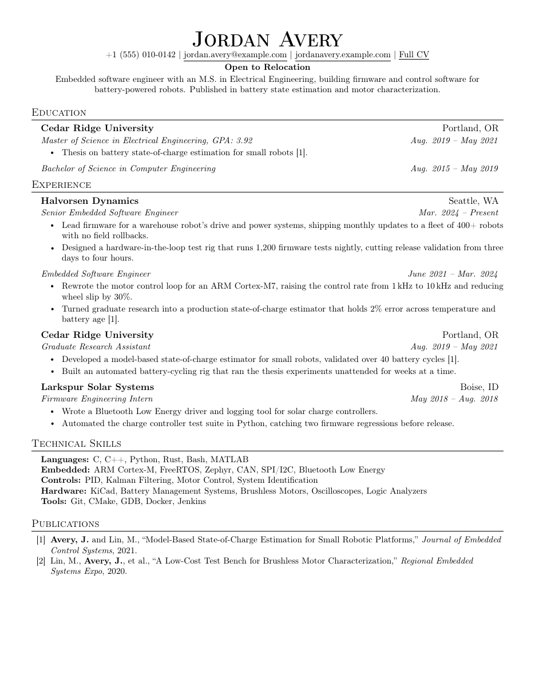
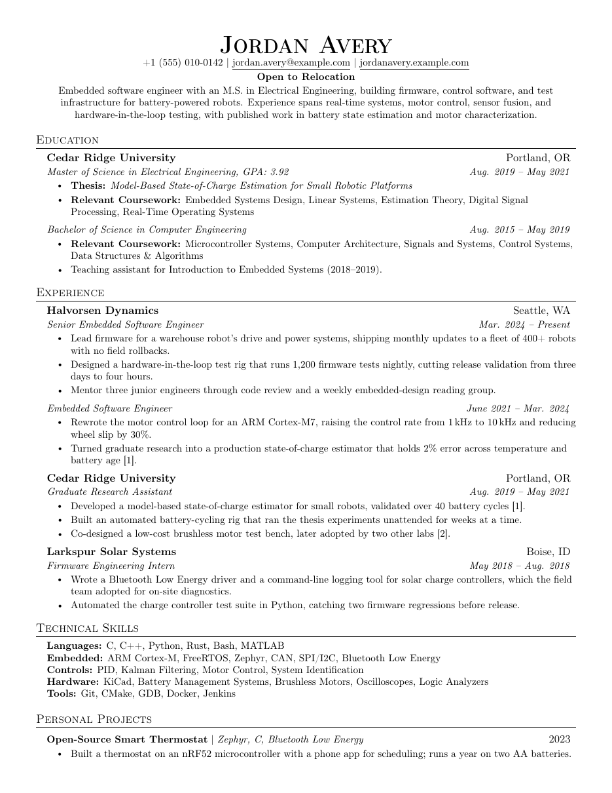
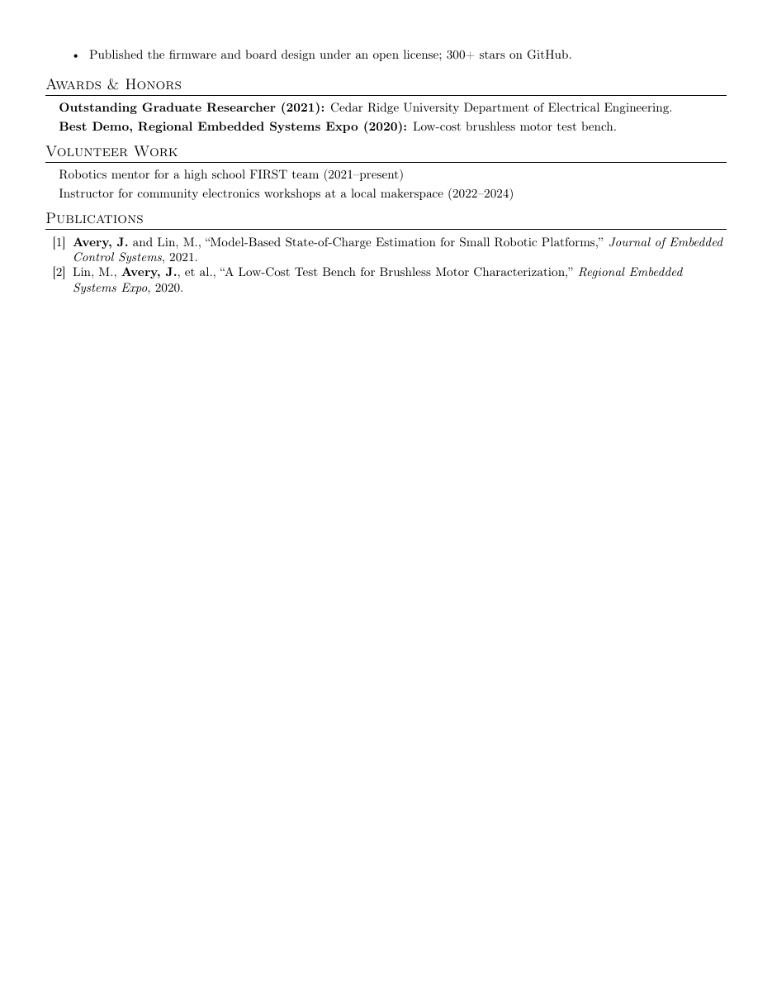

# Dual Resume/CV Template

One set of LaTeX files, two PDFs: a one-page **resume** and a full **CV**.
Write each entry once and mark only what differs. Based on
[Jake's Resume](https://github.com/jakegut/resume).

<p align="center">
  
  
  
</p>
<p align="center"><sub>
  Resume (left) and CV (right) from the same files. The example person is
  fictional.
</sub></p>

## Quick start

1. **Use this template** > **Create a new repository**.
2. Replace the example content in `sections/`.
3. Set `PDF_NAME` at the top of `.github/workflows/build-pdfs.yml`.
4. Compile `resume.tex` or `cv.tex`:

| Where          | How                                                                    |
| -------------- | ---------------------------------------------------------------------- |
| Overleaf, paid | **New Project** > **Import from GitHub**                               |
| Overleaf, free | **Code** > **Download ZIP**, then **New Project** > **Upload Project** |
| Locally        | `latexmk -pdf resume.tex cv.tex` (TeX Live + `cm-super`)               |

**Overleaf tips**
- Set **Menu** > **Settings** > **Main document** to `resume.tex` or
  `cv.tex`.
- GitHub sync: if Overleaf asks, choose **Authorize GitHub Workflow files**.
  After changing files on GitHub, pull them into Overleaf.

## Files

| File                     | Purpose                                      |
| ------------------------ | -------------------------------------------- |
| `resume.tex`, `cv.tex`   | Compile these                                |
| `main.tex`               | Section order; which sections are CV-only    |
| `sections/*.tex`         | Your content, one file per section           |
| `sections/preamble.tex`  | Paper size, fonts, margins                   |
| `sections/macros.tex`    | The commands below                           |

## Writing entries

```latex
\resumeSubHeadingListStart
  \resumeOrg{Company}{City, ST}
  \resumeTitle{Senior Engineer}{2024 -- Present}
  \resumeItemListStart
    \resumeItem{A bullet.}
  \resumeItemListEnd
  \resumeTitle{Engineer}{2021 -- 2024}  % a promotion: same company
\resumeSubHeadingListEnd
```

| Command                             | Use                               |
| ----------------------------------- | --------------------------------- |
| `\resumeOrg{name}{location}`        | Starts an entry                   |
| `\resumeTitle{title}{dates}`        | Job or degree; repeat for more    |
| `\resumeItem{text}`                 | Bullet                            |
| `\resumeProjectHeading{name}{date}` | Project                           |
| `\resumeSubItem{text}`              | Unbulleted line, e.g. an award    |
| `\pubitem{key}{citation}`           | Numbered publication              |
| `\pubcite{key}`                     | Cites it, e.g. `[1]`              |

## Resume vs. CV

```latex
\resumeItem{In both.}
\cvonly{\resumeItem{CV only.}}
\resumeonly{\resumeItem{Resume only.}}
\cvresume{\resumeItem{CV wording.}}{\resumeItem{Resume wording.}}
```

- Unmarked text appears in both.
- CV-only sections sit inside `\ifcv ... \fi` in `main.tex`.
- In a URL inside these commands, write `%` and `#` as `\%` and `\#`.

## Layout

- **Paper:** change `letterpaper` to `a4paper` in `sections/preamble.tex`.
- **Font:** uncomment one of the options in `sections/preamble.tex`.
- **Page fit:** spacing is fixed, so long content moves to the next page
  instead of squeezing. The build warns if the resume passes one page.

## GitHub Actions

Every push to `main` builds both PDFs. A LaTeX error or an unknown
`\pubcite` key fails the build.

- **Download:** **Actions** tab > latest run > **Artifacts**.
- **Publish online:** **Settings** > **Pages** > **Source**: **GitHub
  Actions**, then set `PUBLISH_PAGES: "true"` in the workflow. The PDFs
  appear at `https://<user>.github.io/<repo>/<PDF_NAME>_Resume.pdf` and
  `..._CV.pdf`. On GitHub Free, Pages needs a public repository.

## Credits

Based on [Jake's Resume](https://github.com/jakegut/resume) by Jake
Gutierrez, itself based on [sb2nov/resume](https://github.com/sb2nov/resume)
by Sourabh Bajaj. MIT licensed; see [LICENSE](LICENSE).
